# Engineering Portfolio — Technical & Design Handoff Document
**Project:** Personal Engineering Portfolio of Dipankar Kumar  
**Canonical Project Name:** `Portfolio Build — Learn What the Problem Needs`  
**Document Name:** `PORTFOLIO_HANDOFF.md`  
**Current Release Version:** v2.3 (Texture, Visual Rhythm & Alignment Refinement)  
**RECALL Canonical Project ID:** `195081f5-657b-47fc-a578-57ce84464f75`  
**RECALL Development Session ID:** `4b4d9779-9565-48bd-b34a-88e5752ebe48`  
**Repository Branch:** `master`  
**Live Target:** Vercel Static Deployment  
**Audience:** AI Engineering Assistants & Technical Contributors  

> [!NOTE]
> **Portfolio V2.1 Authentic Paper & Pencil Sketchbook Implementation (24 November 2026):**  
> The portfolio has completed its full transformation into an authentic **illustrated engineering sketchbook** directly benchmarked against `docs/paper-pencil-sketch-reference.png`.  
> - **Visual Identity:** Tactile warm paper canvas (`#F4F1EA`) with dual-grid pencil dot stippling, framed by graphite pencil landscape art (mountains, pine trees, river, wildflowers) on desktop.
> - **Linework & Shadows:** Organic wobbly outlines (`border-radius: 255px 15px 225px 15px / 15px 225px 15px 255px`) across cards and buttons; solid unblurred graphite pencil drop-shadows (`6px 7px 0px rgba(35, 33, 30, 0.88)` for cards, `10px 12px 0px` for modals).  
> - **Typography:** `Architects Daughter` for headings/branding, `Caveat`/`Patrick Hand` for notes and card sublabels, and `Inter` for clean, accessible body copy.  
> - **Project Doodles:** Custom hand-drawn SVGs created and rendered in headers for all 6 projects (RECALL brain+DB, AQIconic air sensor, AI Food Analyzer microscope, Video Game Sales chart, Epic Games controller, Credit Card spending).  
> - **Notebook Details:** Taped polaroid photograph with handwritten caption "MANIT Bhopal '28", crimson highlighter underline on "build it", curved red sketch arrow and annotation note pointing to CTAs, taped principle quote, and wavy footer pencil rule.  
> - **3D & Glass Removal:** `HeroScene.tsx`, Three.js, React Three Fiber, and Drei eliminated. All glassmorphism removed. Production bundle is ~550 kB.  
> - **Structural & Content Integrity:** 100% of sections, responsive grids, data models, modal behavior, and content preserved without fabrication.  

---

## Table of Contents
1. [Executive Summary & Purpose](#1-executive-summary--purpose)
2. [RECALL Memory Registry & Canonical Project Context](#2-recall-memory-registry--canonical-project-context)
3. [Complete Design System & Visual Identity](#3-complete-design-system--visual-identity)
   - [3.1 Visual Philosophy & Reference](#31-visual-philosophy--reference)
   - [3.2 5-Preset 3-Color Theme Architecture](#32-5-preset-3-color-theme-architecture)
   - [3.3 Calibrated Apple Frosted Glass Tokens (v1.8)](#33-calibrated-apple-frosted-glass-tokens-v18)
   - [3.4 Typography System](#34-typography-system)
   - [3.5 Spacing Scale, Containers & Layout Primitives](#35-spacing-scale-containers--layout-primitives)
   - [3.6 Animation, Physics & 3D WebGL Ecosystem](#36-animation-physics--3d-webgl-ecosystem)
4. [Website Structure & Component Hierarchy](#4-website-structure--component-hierarchy)
   - [4.1 Single-Page Architecture](#41-single-page-architecture)
   - [4.2 Component Inventory & Roles](#42-component-inventory--roles)
   - [4.3 Component Hierarchy Diagram](#43-component-hierarchy-diagram)
   - [4.4 Modal & Overlay System](#44-modal--overlay-system)
5. [Technology Stack, Dependencies & Architecture](#5-technology-stack-dependencies--architecture)
   - [5.1 Core Technologies](#51-core-technologies)
   - [5.2 Dependency Manifest & Tooling Gaps](#52-dependency-manifest--tooling-gaps)
   - [5.3 Build & Compilation Configuration](#53-build--compilation-configuration)
   - [5.4 State Management & Context Model](#54-state-management--context-model)
   - [5.5 Content-UI Separation & Asset Pipeline](#55-content-ui-separation--asset-pipeline)
6. [Repository Structure & File Explanations](#6-repository-structure--file-explanations)
7. [Existing Content & Public Portfolio Data](#7-existing-content--public-portfolio-data)
   - [7.1 Identity & Positioning](#71-identity--positioning)
   - [7.2 Featured & Additional Projects](#72-featured--additional-projects)
   - [7.3 Experience & Leadership](#73-experience--leadership)
   - [7.4 Education](#74-education)
   - [7.5 Skills & Working Strengths](#75-skills--working-strengths)
   - [7.6 Current Focus & Learning](#76-current-focus--learning)
   - [7.7 Public Profiles, External URLs & GitHub Alignment](#77-public-profiles-external-urls--github-alignment)
8. [Responsive Behavior Across Breakpoints](#8-responsive-behavior-across-breakpoints)
   - [8.1 Breakpoints](#81-breakpoints)
   - [8.2 Desktop Experience (>= 1024px)](#82-desktop-experience--1024px)
   - [8.3 Tablet Experience (768px – 1023px)](#83-tablet-experience-768px--1023px)
   - [8.4 Mobile Experience (< 768px & < 480px)](#84-mobile-experience--768px--480px)
   - [8.5 Touch Physics & Input Adaptations](#85-touch-physics--input-adaptations)
9. [Current Implementation Status & Known Issues](#9-current-implementation-status--known-issues)
10. [Implementation Milestones & Historical Decision Log](#10-implementation-milestones--historical-decision-log)
   - [10.1 Chronological Development Stages](#101-chronological-development-stages)
   - [10.2 Architectural Guardrails & Explicit Prohibitions](#102-architectural-guardrails--explicit-prohibitions)
   - [10.3 Career Positioning & Content Integrity Rules](#103-career-positioning--content-integrity-rules)
   - [10.4 Privacy Boundaries & File Exclusions](#104-privacy-boundaries--file-exclusions)
11. [Deployment Architecture & Vercel Configuration](#11-deployment-architecture--vercel-configuration)
12. [Feature Matrix: Completed, Partially Implemented & Pending](#12-feature-matrix-completed-partially-implemented--pending)
13. [Critical Documentation Contradictions & Drift Analysis](#13-critical-documentation-contradictions--drift-analysis)
14. [Live Screenshots](#14-live-screenshots)

---

## 1. Executive Summary & Purpose

This document provides a comprehensive technical, design, and historical handoff for the personal engineering portfolio of **Dipankar Kumar**. It is specifically structured so that an incoming AI assistant or software engineer can understand the entire repository, source code, data pipelines, visual styling, responsive layouts, motion physics, and operational boundaries without guessing or introducing breaking regressions.

The core identity driving this project is:
> **"I learn what the problem needs and build it."**

The site communicates practical software engineering ability, application development, systems integration, and technical agility.

---

## 2. RECALL Memory Registry & Canonical Project Context

This repository is canonically registered and synchronized with **RECALL** (Dipankar's persistent context and memory engine for AI coding agents). All incoming agents must respect the registered project metadata, custom instructions, and decision memories:

### 2.1 Canonical Identifiers
- **RECALL Project ID:** `195081f5-657b-47fc-a578-57ce84464f75`
- **Canonical Project Name:** `Portfolio`
- **Canonical Keyword:** `Portfolio Build — Learn What the Problem Needs`
- **RECALL Development Session ID:** `4b4d9779-9565-48bd-b34a-88e5752ebe48` (`Portfolio Development — Stage 3`)

### 2.2 Active Custom Instructions in RECALL
RECALL enforces custom instructions with strict precedence over general memory:
1. **Instruction `69b84077-3c8d-4f05-bf42-6f8ea207c20f` (Global):**
   > *"My name is Dipankar only."*
2. **Instruction `00f35cb6-1621-4926-b462-c8f1ebddf9e5` (Global):**
   > *"my name is dipankar kumar"*
3. **Instruction `693647df-ea0d-4e19-a158-2b1fcea04c60` (Project-Level):**
   > **Portfolio Project Core Governance:**
   > - **Documentation Hierarchy:** (1) Explicit instruction from Dipankar, (2) `docs/PRD.md`, (3) `docs/DESIGN.md`, (4) `docs/CONTENT.md`, (5) `docs/ARCHITECTURE.md`, (6) `docs/TECH_STACK.md`, (7) `docs/DEVELOPMENT_RULES.md`, (8) Existing implementation. Stop and ask before making major architectural changes or introducing frameworks/backends/databases.
   > - **Content Integrity & Attribution:** Never fabricate or exaggerate experience, job titles, metrics, or achievements. `docs/CONTENT.md` is the sole source of truth. Accurately distinguish collaborative from individual work. Position Dipankar as an early-career software engineer learning what the problem needs and building it, never as a senior engineer or specialized ML expert. Never expose private personal data.
   > - **Architecture & Design:** Keep implementation data-driven and clean. Portfolio data lives in typed TypeScript modules in `src/data/` separated from UI components. Adhere to the approved design system.
   > - **Verification & Scope:** Keep changes focused with zero unrequested scope creep. Always verify with `npm run build` and check responsive layouts across mobile, tablet, and desktop before concluding any task. Never claim untested functionality works.

---

## 3. Complete Design System & Visual Identity

### 3.1 Visual Philosophy & Reference
- **Primary Design Reference:** Approved Picto-style portfolio direction (inspired by `https://khurramshafeeq.vercel.app/`), adapted for a technical software engineering profile.
- **Visual Identity:** Modern, clean, calm, and grounded. The interface avoids gratuitous "hacker terminal" tropes, decorative matrix rain, or neon-green gamer aesthetics.
- **Core Principle:** *"The website should make the work memorable, not the website itself."*
- **Version 1.8 Calibration:** The UI layers an **Apple VisionOS frosted glass (glassmorphism)** surface system over a persistent, viewport-locked 3D WebGL background layer. The 3D scene sits behind a direct 10px GPU blur, while surface cards feature deepened backdrops (0.72–0.78 opacity) to guarantee WCAG AAA contrast and zero text washout.

---

### 3.2 5-Preset 3-Color Theme Architecture
The portfolio implements a dynamic, user-selectable **5-Preset 3-Color Architecture** managed by `ThemeContext.tsx` and configured via CSS Custom Properties in `src/styles/variables.css`. Every theme strictly binds three curated colors into structural roles:
1. **Base (`--color-base` / `--color-background`)**: Page foundation, HTML background, ambient 3D scene lighting, and frosted glass substrate.
2. **Secondary (`--color-secondary` / `--color-border-strong`)**: Primary readable typography, card specular borders, subheadings, and 3D wireframe mesh outlines.
3. **Accent (`--color-accent` / `--color-btn-primary-bg`)**: Interactive buttons, badges, active hover glows, focus rings, and solid 3D geometric meshes.

#### Theme Presets Table
| Theme ID | Display Name | Base Color | Secondary Color | Accent Color | Button Text | Contrast Ratios (Verified in RECALL) | Tagline / Description |
| :--- | :--- | :--- | :--- | :--- | :--- | :--- | :--- |
| `royal` (Default) | **Royal** | `#3A0F34` | `#DDE3E8` | `#EAAA00` | `#3A0F34` | Body: 11.8:1 (AAA) \| Button: 7.2:1 (AAA) | Deep Purple, Light Grey-Blue & Gold |
| `cyber` | **Cyber** | `#0A0A0A` | `#007BA7` (Text: `#EAF6FA`) | `#FF2D95` | `#0A0A0A` | Body: 18.2:1 (AAA) \| Button: 7.4:1 (AAA) | Cyber Black, Cerulean Cyan & Neon Pink |
| `mocha` | **Mocha** | `#6F4E37` | `#E5E4E2` | `#E6E0F0` | `#6F4E37` | Body: 11.9:1 (AAA) \| Button: 7.1:1 (AAA) | Warm Mocha, Platinum & Pale Lilac |
| `emerald` | **Emerald** | `#046A38` | `#F9EBD7` | `#E34222` | `#F9EBD7` | Body: 12.1:1 (AAA) \| Button: 7.3:1 (AAA) | Forest Emerald, Antique Linen & Flame Orange |
| `carbon` | **Carbon** | `#2A2A2A` | `#C0C0C0` (Text: `#F2F2F2`) | `#E10600` | `#FFFFFF` | Body: 14.5:1 (AAA) \| Button: 8.1:1 (AAA) | Carbon Charcoal, Silver & Crimson Red |

*Note on Contrast Tints:* In `cyber` and `carbon`, high-contrast tints (`#EAF6FA` and `#F2F2F2`) are used for body typography to achieve strict WCAG AAA readability against ultra-dark foundations, while `#007BA7` and `#C0C0C0` remain prominent across glass borders, badges, subheadings, and 3D wireframes.

---

### 3.3 Calibrated Apple Frosted Glass Tokens (v1.8)
Glass containers are implemented using pure CSS with hardware acceleration:
- **Scene GPU Blur:** `.global-scene-container` uses `filter: blur(10px) saturate(140%)` directly on the fixed WebGL container. (Reduced from 22px down to 10px in commit `ea532a5` per RECALL decision memory `4c8bd792-ea09-4b51-9164-12bde8249ead`).
- **Card Backdrop (`--glass-bg` / `--color-surface-glass`):**
  - Royal: `rgba(35, 9, 32, 0.72)`
  - Cyber: `rgba(10, 10, 10, 0.78)`
  - Mocha: `rgba(60, 42, 30, 0.75)`
  - Emerald: `rgba(3, 60, 31, 0.75)`
  - Carbon: `rgba(26, 26, 26, 0.78)`
- **Specular Border (`--glass-border`):** `1px solid rgba(221, 227, 232, 0.16)`
- **Inner Specular Sheen & Depth Shadow (`--glass-shadow`):** `0 12px 32px rgba(0, 0, 0, 0.35), inset 0 1px 0 rgba(221, 227, 232, 0.16)`
- **Hover Glow & Elevation (`--glass-shadow-hover`):** `0 16px 40px var(--color-btn-glow), inset 0 1px 0 var(--color-accent)`
- **Modal Glass Backdrop:** `background: rgba(20, 4, 18, 0.75); backdrop-filter: blur(12px);`

---

### 3.4 Typography System
Typography is strictly system-first to maximize load performance and eliminate font shifts.
- **Font Stacks:**
  - Body & Headings: `var(--font-sans)` = `system-ui, -apple-system, BlinkMacSystemFont, 'Segoe UI', Roboto, 'Helvetica Neue', Arial, sans-serif`
  - Code / Monospace: `var(--font-mono)` = `ui-monospace, SFMono-Regular, 'SF Mono', Menlo, Consolas, 'Liberation Mono', monospace`
- **Fluid Scale (`clamp`):**
  - Display Small: `clamp(2.5rem, 5vw, 3.5rem)` (40px – 56px)
  - Display Medium (Hero Heading): `clamp(3rem, 6vw, 4.5rem)` (48px – 72px)
  - Display Large: `clamp(3.5rem, 8vw, 6rem)` (56px – 96px)
- **Discrete Scale:**
  - `text-xs`: `0.75rem` (12px)
  - `text-sm`: `0.875rem` (14px)
  - `text-base`: `1rem` (16px)
  - `text-lg`: `1.125rem` (18px)
  - `text-xl`: `1.25rem` (20px)
  - `text-2xl`: `1.5rem` (24px)
  - `text-3xl`: `1.875rem` (30px)
  - `text-4xl`: `2.25rem` (36px)
  - `text-5xl`: `3rem` (48px)
  - `text-6xl`: `3.75rem` (60px)
- **Line Heights:** `tight: 1.1`, `snug: 1.375`, `normal: 1.5`, `relaxed: 1.625`, `loose: 2`.
- **Weights:** `normal: 400`, `medium: 500`, `semibold: 600`, `bold: 700`.

---

### 3.5 Spacing Scale, Containers & Layout Primitives
- **Spacing Scale:** Predictable 4px grid progression:
  - `--space-1`: `0.25rem` (4px)
  - `--space-2`: `0.5rem` (8px)
  - `--space-3`: `0.75rem` (12px)
  - `--space-4`: `1rem` (16px)
  - `--space-5`: `1.25rem` (20px)
  - `--space-6`: `1.5rem` (24px)
  - `--space-8`: `2rem` (32px)
  - `--space-10`: `2.5rem` (40px)
  - `--space-12`: `3rem` (48px)
  - `--space-16`: `4rem` (64px)
  - `--space-20`: `5rem` (80px)
  - `--space-24`: `6rem` (96px)
- **Section Spacing:** `--section-padding-y` = `4rem` (64px); large: `6rem` (96px); small: `3rem` (48px).
- **Navigation Clearance:** `scroll-padding-top: calc(var(--navbar-height) + var(--space-4))` (`80px`), ensuring section headings have breathing room when navigated to.
- **Containers:** Max width `1200px` (`.container`); narrow: `800px` (`.container-narrow`). Horizontal padding scales from `16px` (mobile) to `24px` (tablet) to `32px` (desktop).
- **Navbar Height:** Fixed `64px` (`--navbar-height`).
- **Z-Index System:**
  - WebGL Canvas: `z-index: 0` (`.global-scene-container`)
  - App Content Wrapper: `z-index: 2` (`.app-wrapper`)
  - Dropdown / Menus: `z-index: 100` (`--z-dropdown`)
  - Sticky Navbar: `z-index: 200` (`--z-sticky`)
  - Modal Backdrop: `z-index: 400` (`--z-modal-backdrop`)
  - Modal Window: `z-index: 500` (`--z-modal`)
  - Skip Link / Toast: `z-index: 800` (`--z-toast`)

---

### 3.6 Animation, Physics & 3D WebGL Ecosystem
The application integrates a synchronized, physics-driven motion stack:
1. **Global Smooth Scroll (`lenis`):**
   - Configured in `src/components/motion/SmoothScroll.tsx` via `SmoothScrollProvider`.
   - Settings: `duration: 1.1`, `wheelMultiplier: 1.0`, `touchMultiplier: 1.5`, `infinite: false`.
   - Synchronized directly to the GSAP ticker (`gsap.ticker.add(...)`).
   - Modal prevention: `data-lenis-prevent="true"`, preventing wheel hijacking inside scrollable modals.
   - Respects `prefers-reduced-motion: reduce`.
2. **Scroll-Triggered Reveals (`gsap` + `ScrollTrigger`):**
   - Project cards and experience entries reveal with subtle scale-up (`scale: 0.95 -> 1`) and y-float (`y: 40 -> 0`).
   - Parallax scrub on project thumbnails (`yPercent: -6 -> 6`).
3. **Micro-Interactions (`framer-motion`):**
   - Hero entrance elements use staggered spring animation (`duration: 0.8s`, `ease: [0.16, 1, 0.3, 1]`).
   - `Magnetic.tsx` wraps interactive CTA buttons, brand name, and links to provide magnetic cursor pulling on hover (`strength: 0.2-0.25`, `stiffness: 220`, `damping: 15`). Disabled on coarse touch pointers.
4. **Persistent 3D WebGL Layer (`three`, `@react-three/fiber`, `@react-three/drei`):**
   - Mounted at root in `src/App.tsx` via `src/sections/Hero/HeroScene.tsx`.
   - Fixed viewport container (`position: fixed; inset: 0; pointer-events: none; z-index: 0;`).
   - 22 floating 3D shapes (`torusKnot`, `icosahedron`, `octahedron`) spanning the entire scroll height (`y: +2.5` to `-23.0`).
   - Individual continuous ambient spin on local axes (`delta * rotationSpeed`).
   - Damped scroll-driven tumble (`Math.PI * 6`) tracking normalized page scroll.
   - Cursor parallax tracking clamped to 8 degrees (`±0.15` radians).
   - Dynamically subscribes to `useTheme()`:
     - Ambient and rim lights match **Base color** (`intensity: 3.5 - 4.5`).
     - Directional key lights and solid shapes match **Accent color** (`emissiveIntensity: 0.70`).
     - Wireframe meshes and secondary point light match **Secondary color** (`emissiveIntensity: 0.55`).
   - Wrapped in `WebGLErrorBoundary` with graceful radial gradient fallback if WebGL fails.

---

## 4. Website Structure & Component Hierarchy

### 4.1 Single-Page Architecture
The portfolio functions as a high-performance Single Page Application (SPA). All content is rendered along one structured page with anchor jump links.

Section navigation order:
1. `Navigation` (Sticky header, brand logo, desktop links, theme switcher, mobile drawer)
2. `HeroSection` (`#hero`)
3. `AboutSection` (`#about`)
4. `ProjectsSection` (`#projects`)
5. `ExperienceSection` (`#experience`)
6. `SkillsSection` (`#skills`)
7. `EducationSection` (`#education`)
8. `LearningSection` (`#learning`)
9. `ContactSection` (`#contact`)
10. `Footer`

---

### 4.2 Component Inventory & Roles

| Component File Path | Component Name | Export Type | Role & Responsibilities |
| :--- | :--- | :--- | :--- |
| `src/App.tsx` | `App` | Default | Root shell. Wraps `ThemeProvider`, `SmoothScrollProvider`, fixed `HeroScene`, and main section flow. |
| `src/main.tsx` | - | Entry point | Mounts React 19 root, imports global CSS cascade (`variables.css`, `globals.css`, `components.css`). |
| `src/context/ThemeContext.tsx` | `ThemeProvider`, `useTheme` | Named | Manages 5-preset theme selection, `localStorage` persistence, `<meta name="theme-color">` updates, and HTML `data-theme`. |
| `src/components/navigation/Navigation.tsx` | `Navigation` | Named | Sticky glass navbar, anchor links, theme selector trigger, mobile drawer toggle, Escape key listener, scroll locking. |
| `src/components/theme/ThemeSelector.tsx` | `ThemeSelector` | Named | Apple VisionOS frosted glass pill button with 3-color swatch cluster and accessible popover menu. |
| `src/components/motion/SmoothScroll.tsx` | `SmoothScrollProvider`, `useSmoothScroll` | Named | Lenis initialization, GSAP ticker sync, modal scroll prevention, anchor link smooth scrolling. |
| `src/components/motion/Magnetic.tsx` | `Magnetic` | Named | Framer Motion magnetic pull effect on desktop cursor hover. |
| `src/components/projects/ProjectDetailModal.tsx` | `ProjectDetailModal` | Named | Accessible dialog for project details, screenshot gallery, challenge lists, links, focus trap, and Lenis lock. |
| `src/components/ui/Button.tsx` | `Button` | Named | Reusable button primitive with primary, secondary, ghost variants and spinner loading state. |
| `src/components/ui/Card.tsx` | `Card`, `CardContent`, etc. | Named | Reusable glass surface primitive with hover elevation. |
| `src/components/ui/Link.tsx` | `Link` | Named | Accessible anchor wrapper supporting external new-tab security (`noopener noreferrer`) and icon decorators. |
| `src/components/ui/Section.tsx` | `Section`, `Heading`, `Container` | Named | Semantic layout section wrapper with consistent padding and typography hierarchy. |
| `src/components/ui/Tag.tsx` | `Tag` | Named | Status badge and technology tag primitive supporting project statuses and category variants. |
| `src/sections/Hero/HeroScene.tsx` | `HeroScene` | Named | React Three Fiber 3D scene rendering floating geometric meshes, lighting, scroll tumble, and theme reactivity. |
| `src/sections/Hero/HeroSection.tsx` | `HeroSection` | Named | Dominant headline ("I learn what the problem needs and build it"), supporting text, and magnetic CTA buttons. |
| `src/sections/About/AboutSection.tsx` | `AboutSection` | Named | Profile photograph, 3-paragraph biographical narrative, and core engineering mindset. |
| `src/sections/Projects/ProjectsSection.tsx` | `ProjectsSection` | Named | 4 featured project cards + 2 additional project cards, GSAP entrance triggers, and detail modal controller. |
| `src/sections/Experience/ExperienceSection.tsx` | `ExperienceSection` | Named | Professional experience cards, leadership timeline, and hackathon achievements. |
| `src/sections/Skills/SkillsSection.tsx` | `SkillsSection` | Named | 3 defensible skill categories (Programming, App Dev, Tools) and 10 working strengths chips. |
| `src/sections/Education/EducationSection.tsx` | `EducationSection` | Named | Academic credentials (MANIT MCA, DU CVS BSc, Senior Secondary, Secondary) with priority visual styling. |
| `src/sections/Learning/LearningSection.tsx` | `LearningSection` | Named | 2-column active learning cards (Primary Focus, Active Exploration) and guiding learning principle quote. |
| `src/sections/Contact/ContactSection.tsx` | `ContactSection` | Named | Primary email glass CTA card, social profile links, and interactive one-click Discord handle copy button. |
| `src/sections/Contact/Footer.tsx` | `Footer` | Named | Sign-off appreciation text and core engineering philosophy tagline. |

---

### 4.3 Component Hierarchy Diagram

```mermaid
graph TD
  App["App.tsx"] --> ThemeProvider["ThemeProvider (ThemeContext.tsx)"]
  ThemeProvider --> SmoothScrollProvider["SmoothScrollProvider (SmoothScroll.tsx)"]
  
  SmoothScrollProvider --> GlobalScene["div.global-scene-container (HeroScene.tsx)"]
  GlobalScene --> Canvas["R3F Canvas"]
  Canvas --> Scene["Scene (Ambient + Directional + Point Lights)"]
  Scene --> Shapes["22x FloatingShape (TorusKnot / Icosahedron / Octahedron)"]

  SmoothScrollProvider --> AppWrapper["div.app-wrapper"]
  AppWrapper --> SkipLink["a.skip-link"]
  AppWrapper --> Navigation["Navigation.tsx"]
  Navigation --> MagneticBrand["Magnetic (Brand Logo)"]
  Navigation --> NavLinks["Magnetic (Desktop Nav Links)"]
  Navigation --> DesktopTheme["ThemeSelector.tsx (Desktop)"]
  Navigation --> MobileDrawer["div.mobile-menu"]
  MobileDrawer --> MobileTheme["ThemeSelector.tsx (Mobile)"]

  AppWrapper --> Main["main#main-content"]
  Main --> Hero["HeroSection.tsx"]
  Hero --> HeroMotion["motion.div (Staggered Children)"]
  HeroMotion --> HeroCTAs["Magnetic (View Projects, GitHub, Resume)"]

  Main --> About["AboutSection.tsx"]
  About --> ProfileImg["img (profile.png)"]
  About --> BioText["p (Approved Bio Copy)"]

  Main --> Projects["ProjectsSection.tsx"]
  Projects --> FeaturedCards["4x ProjectCard (RECALL, AQIconic, Food Analyzer, Sales)"]
  Projects --> AdditionalCards["2x ProjectCard (Epic Games Clone, Credit Card)"]
  Projects --> ProjectModal["ProjectDetailModal.tsx (Overlay Dialog)"]

  Main --> Experience["ExperienceSection.tsx"]
  Experience --> ExpCards["2x Experience Entry (Ekara, Outlier)"]
  Experience --> LeadershipCards["3x Leadership Entry (Catalyst, SKILLX, ENCRYPT)"]
  Experience --> AchievementCards["1x Achievement (Smart India Hackathon)"]

  Main --> Skills["SkillsSection.tsx"]
  Skills --> SkillCards["3x SkillGroup (Programming, App Dev, Tools)"]
  Skills --> StrengthChips["10x Working Strength Chips"]

  Main --> Education["EducationSection.tsx"]
  Education --> EduCards["4x EducationEntry (MANIT, DU, Class XII, Class X)"]

  Main --> Learning["LearningSection.tsx"]
  Learning --> LearningCards["2x LearningFocus (Primary Focus, Active Exploration)"]
  Learning --> PrincipleQuote["blockquote.learning-principle"]

  Main --> Contact["ContactSection.tsx"]
  Contact --> EmailCard["Magnetic (Primary Email Glass Card)"]
  Contact --> SocialButtons["Magnetic (LinkedIn, GitHub, LeetCode, HackerRank)"]
  Contact --> DiscordCopy["button.contact-copy-btn (Clipboard API / Fallback)"]

  AppWrapper --> Footer["Footer.tsx"]
```



---

### 4.4 Modal & Overlay System
- **Component:** `src/components/projects/ProjectDetailModal.tsx`
- **Activation:** Triggered when clicking any project card or pressing `Enter`/`Space` while focused on a card.
- **Accessibility & Focus Trap:**
  - Focus is automatically trapped within the modal container.
  - Initial focus directs to the close button (`.modal-close`).
  - Pressing `Escape` closes the modal immediately and restores focus to the previously active project card.
  - Screen readers are alerted via `role="dialog"`, `aria-modal="true"`, and `aria-labelledby="modal-title"`.
- **Scroll Containment & Physics:**
  - Pauses Lenis scroll upon open (`stop()`) and resumes upon close (`start()`).
  - Backdrop and modal container include `data-lenis-prevent="true"`, `data-lenis-prevent-wheel="true"`, and `data-lenis-prevent-touch="true"`.
  - Body element is locked with `overflow: hidden`.
  - Inner content is bounded to `max-height: 85vh` with native smooth scrolling (`overscroll-behavior: contain`).

---

## 5. Technology Stack, Dependencies & Architecture

### 5.1 Core Technologies
- **UI Framework:** React 19 (`19.3.0`) + React DOM (`19.3.0`)
- **Language:** TypeScript 7.0.2 (`target: ES2020`, strict type checking enabled)
- **Build System:** Vite 8.3.3 (`@vitejs/plugin-react` 6.1.2)
- **Styling Strategy:** Pure modern Vanilla CSS with CSS Custom Properties, CSS Grid, Flexbox, and fluid typography. Zero styling frameworks in the portfolio build.
- **Routing:** Single-page anchor navigation (`#hero`, `#about`, etc.) paired with Lenis scroll and `window.history.pushState`.

---

### 5.2 Dependency Manifest & Tooling Gaps
Extracted from `package.json`:

```json
{
  "dependencies": {
    "@react-three/drei": "^10.7.9",
    "@react-three/fiber": "^9.8.2",
    "@types/three": "^0.186.0",
    "framer-motion": "^14.6.0",
    "gsap": "^3.15.0",
    "lenis": "^1.3.27",
    "react": "^19.3.0",
    "react-dom": "^19.3.0",
    "three": "^0.186.1"
  },
  "devDependencies": {
    "@types/react": "^19.3.0",
    "@types/react-dom": "^19.3.0",
    "@vitejs/plugin-react": "^6.1.2",
    "typescript": "^7.0.2",
    "vite": "^8.3.3"
  }
}
```

*Tooling Gap Documented in RECALL (`7bb26c7a`):* The `npm run lint` script references `eslint`, but `eslint` is currently omitted from `devDependencies`. Per repository governance rules, no unrequested dependencies are added; contributors run `npm run build` (`tsc && vite build`) as the primary gate.

---

### 5.3 Build & Compilation Configuration
- **Vite Config (`vite.config.ts`):**
  - Path alias: `@` resolves to `./src`.
  - Output directory: `dist`.
  - Source maps: `sourcemap: true`.
  - Dev server port: `3000` (strictly configured in `vite.config.ts`; do not look for port 5173).
- **TypeScript Config (`tsconfig.json` & `tsconfig.node.json`):**
  - Strict mode enabled (`strict: true`, `noUnusedLocals: true`, `noUnusedParameters: true`, `noFallthroughCasesInSwitch: true`).
  - Module resolution: `bundler`.
  - JSX transform: `react-jsx`.
- **Production Build Command:**
  ```bash
  npm run build
  # Executes: tsc && vite build
  ```

---

### 5.4 State Management & Context Model
The application avoids third-party state libraries (Redux, Zustand, MobX). State is managed through two simple patterns:
1. **Global Theme Context (`src/context/ThemeContext.tsx`):**
   - Provides `theme` (`ThemeId`), `themeConfig` (`ThemeConfig`), `setTheme`, and `availableThemes`.
   - Persists user selection to `localStorage` under key `'portfolio-color-theme'`.
   - Synchronizes `document.documentElement.setAttribute('data-theme', theme)`.
   - Dynamically updates `<meta name="theme-color">` to match `themeConfig.colors.base`.
2. **Local Component State (`useState`):**
   - Modal selection: `selectedProject` in `ProjectsSection.tsx`.
   - Mobile navigation: `isOpen` in `Navigation.tsx`.
   - Theme popover: `isOpen` in `ThemeSelector.tsx`.
   - Discord handle copied state: `copied` in `ContactSection.tsx`.

---

### 5.5 Content-UI Separation & Asset Pipeline
All portfolio data is separated from JSX markup. Modifying profile information, adding a project, or updating work experience only requires editing the structured TypeScript models in `src/data/`.

*Asset Pipeline Implementation (RECALL Memory `24d1455a`):*
In Stage 3, string image paths (`/src/assets/...`) were replaced with ESM static imports (`import img from '...'`) in `src/data/profile.ts` and `src/data/projects.ts`. This allows Vite to hash, optimize, and bundle all 16 assets into `dist/assets/` during `npm run build`, eliminating runtime asset 404s.

---

## 6. Repository Structure & File Explanations

```text
D:\proj\Portfolio
├── .agents/
│   └── mcp_config.json              # Agent workspace MCP server configuration (STRICTLY UNTRACKED: contains local machine paths)
├── .git/                            # Local git version history
├── dist/                            # Production build artifact (generated by npm run build)
├── docs/                            # Project specifications & documentation
│   ├── ARCHITECTURE.md              # v1.0 Technical structure & application model
│   ├── CONTENT.md                   # v1.0 Content source of truth & public copy
│   ├── DESIGN.md                    # v1.8 Visual design, 5-preset themes & frosted glass spec
│   ├── DEVELOPMENT_RULES.md         # Engineering constraints, verification & contribution rules
│   ├── PRD.md                       # Product requirements, goals, audience & scope
│   ├── TECH_STACK.md                # v1.0 Technology choices & constraints
│   └── screenshots/                 # Captured live screenshots
│       ├── desktop.png              # Latest desktop view (1440x900)
│       └── mobile.png               # Latest mobile view (390x844)
├── public/                          # Public static assets copied verbatim to dist
│   ├── favicon.svg                  # Vector browser tab favicon
│   └── robots.txt                   # Search crawler directives
├── src/                             # Application source code
│   ├── assets/
│   │   ├── icons/                   # (Reserved for custom svg iconography)
│   │   └── images/
│   │       ├── misc/                # Miscellaneous graphic assets
│   │       ├── profile/
│   │       │   └── profile.png      # Professional headshot photograph
│   │       └── projects/
│   │           ├── ai-food-analyzer/# Microscopic analysis preview images
│   │           ├── aqiconic/        # Desktop Qt/QML UI screenshots
│   │           ├── epic-games-clone/# Epic Games Store clone screenshot
│   │           ├── recall/          # RECALL UI light/dark, hero, and architecture diagrams
│   │           └── video-game-sales-analysis/ # Power BI dashboard report views
│   ├── components/
│   │   ├── motion/
│   │   │   ├── Magnetic.tsx         # Framer Motion cursor pull component
│   │   │   ├── SmoothScroll.tsx     # Lenis smooth scroll provider & GSAP ticker integration
│   │   │   └── index.ts             # Motion barrel exports
│   │   ├── navigation/
│   │   │   └── Navigation.tsx       # Sticky glass header & mobile drawer
│   │   ├── projects/
│   │   │   ├── ProjectDetailModal.tsx # Project modal dialog
│   │   │   └── index.ts             # Projects barrel exports
│   │   ├── theme/
│   │   │   └── ThemeSelector.tsx    # 5-theme selector glass pill & popover
│   │   └── ui/
│   │       ├── Button.tsx           # Button primitive
│   │       ├── Card.tsx             # Card & glass panel primitive
│   │       ├── Link.tsx             # Accessible anchor wrapper
│   │       ├── Section.tsx          # Section, Heading, Container primitives
│   │       ├── Tag.tsx              # Status & category tag primitive
│   │       └── index.ts             # UI barrel exports
│   ├── context/
│   │   └── ThemeContext.tsx         # 5-preset theme state provider & hooks
│   ├── data/
│   │   ├── education.ts             # Academic degrees & school history
│   │   ├── experience.ts            # Professional internships, leadership & achievements
│   │   ├── index.ts                 # Data barrel exports
│   │   ├── learning.ts              # Primary focus, active exploration & learning principle
│   │   ├── profile.ts               # Core bio, taglines, links & social profiles
│   │   ├── projects.ts              # 6 project specifications & ESM image imports
│   │   └── skills.ts                # 3 defensible skill groups & 10 working strengths
│   │   └── types.ts                 # TypeScript data contracts & interfaces
│   ├── layouts/                     # (Reserved for future multi-page templates)
│   ├── sections/
│   │   ├── About/AboutSection.tsx   # Biography & photo section
│   │   ├── Contact/
│   │   │   ├── ContactSection.tsx   # Email, social links, Discord copy button
│   │   │   └── Footer.tsx           # Closing tagline & attribution
│   │   ├── Education/EducationSection.tsx # Degrees & schooling list
│   │   ├── Experience/ExperienceSection.tsx # Internships, leadership, achievements
│   │   ├── Hero/
│   │   │   ├── HeroScene.tsx        # React Three Fiber 3D background scene
│   │   │   └── HeroSection.tsx      # Landing hero text & primary CTAs
│   │   ├── Learning/LearningSection.tsx # Current technical exploration
│   │   ├── Projects/ProjectsSection.tsx # Featured & additional projects grid
│   │   └── Skills/SkillsSection.tsx # Skills cards & working strengths
│   ├── styles/
│   │   ├── components.css           # Component styles (cards, modal, navbar, buttons, tags)
│   │   ├── globals.css              # Reset, utility classes, typography base, layout primitives
│   │   ├── index.css                # Style manifest
│   │   └── variables.css            # 5-theme color definitions, glass tokens, spacing scale
│   ├── App.tsx                      # Root application layout shell
│   ├── main.tsx                     # Vite DOM entry point
│   └── vite-env.d.ts                # Vite client type declarations
├── .gitignore                       # Git ignore paths (node_modules, dist, etc.)
├── AGENTS.md                        # Master governance rules for AI coding assistants
├── index.html                       # HTML5 entry template & theme flash prevention script
├── package-lock.json                # Locked npm dependency graph
├── package.json                     # Project manifest, scripts & dependencies
├── README.md                        # Repository overview & setup guide
├── tsconfig.json                    # Application TypeScript configuration
├── tsconfig.node.json               # Vite build tools TypeScript configuration
├── vercel.json                      # Vercel deployment & rewrite configuration
└── vite.config.ts                   # Vite bundler configuration
```

---

## 7. Existing Content & Public Portfolio Data

### 7.1 Identity & Positioning
- **Full Name:** Dipankar Kumar (Display: Dipankar)
- **Role:** Software Engineer
- **Current Academic Stage:** MCA Student at Maulana Azad National Institute of Technology (MANIT), Bhopal (2025–2028)
- **Location:** Bhopal, Madhya Pradesh, India
- **Core Taglines:**
  - Primary: *"I learn what the problem needs and build it."*
  - Supporting: *"Software Engineer focused on application development and AI integration — understanding problem needs, designing practical systems, and building working software."*
- **Approved Bio Narrative:** Systems-oriented developer who explores unfamiliar problem spaces, learns what the problem requires, and builds functioning software. Grounded in continuous learning (*a polymath in progress*), with practical experience in agentic AI tooling, desktop software, hardware–software integration, and data analytics.

---

### 7.2 Featured & Additional Projects

#### 1. RECALL (Featured #1 — Premier Project)
- **Type:** AI Systems / Developer Tooling / Context Engine
- **Status:** Completed (Active v1.0.1)
- **Collaboration:** Co-developed with Shiva Infinity
- **Summary:** Local, persistent context and memory engine for AI coding agents. Implements SQLite canonical storage, deterministic context retrieval, strict custom-instruction precedence (user instructions > supersession > memory), Model Context Protocol (MCP) server, and a developer web dashboard.
- **Dipankar's Contribution:** Modular architecture, database persistence layer, canonical SQLite ledger, memory lifecycle and compaction, precedence arbitration, fault-tolerant persistence against vector index crashes, 280+ regression tests, and dashboard UI refinement.
- **Technologies:** Python, SQLite, MCP, FastAPI, ChromaDB, React, Tailwind CSS, TypeScript
- **Repository:** `https://github.com/dp9318/RECALL`
- **Images:** Dark UI, Light UI, Architecture Diagram, Banner Hero.

#### 2. AQIconic (Featured #2)
- **Type:** Desktop Application / Environmental Monitoring / Hardware Integration
- **Status:** In Progress (Phase 3)
- **Collaboration:** Collaborative project
- **Summary:** Windows desktop platform combining Qt/QML/PySide6 with ESP32 microcontrollers for real-time environmental air-quality data collection, visualization, and hardware control via Socket.IO.
- **Dipankar's Contribution:** Desktop application development, Qt/QML and PySide6 integration, software–hardware communication layer, Socket.IO bidirectional data flow, and ESP32 integration.
- **Technologies:** Qt, QML, PySide6, Python, C++, ESP32, Socket.IO
- **Repository:** `https://github.com/dp9318/AQIconic`
- **Images:** 4 application interface screenshots.

#### 3. AI Food Analyzer (Featured #3)
- **Type:** Machine Learning / Computer Vision / Research
- **Status:** In Progress
- **Guidance:** Dr. Jay Kumar Jain, Assistant Professor
- **Summary:** Computer vision system exploring microscopic food-sample image analysis and bacterial pattern detection using YOLO to assess food purity and hygiene (tested against *Lactobacillus* species: *L. delbrueckii*, *L. salivarius*).
- **Technologies:** Python, YOLO, Jupyter Notebook, NumPy
- **Repository:** `https://github.com/dp9318/AI-Food-Analyzer`
- **Images:** Microscopic detection test image.

#### 4. Video Game Sales Analysis (1971–2024) (Featured #4)
- **Type:** Data Analytics / Visualization
- **Status:** Completed
- **Summary:** Interactive Power BI dashboard analyzing 50+ years of global video-game sales data across platform, genre, regional, and market trends using custom DAX measures.
- **Technologies:** Power BI, DAX
- **Repository:** `https://github.com/dp9318/Game-Sales-Analysis-1971-2024-`
- **Images:** Sales over years, console genre, regional popularity, top titles.

#### 5. Epic Games Clone (Additional Project #1)
- **Type:** Web Application / Full-Stack Learning Project
- **Status:** In Progress
- **Summary:** Learning implementation of an Epic Games Store e-commerce interface with catalog discovery and authentication flows.
- **Technologies:** HTML, CSS, JavaScript
- **Repository:** `https://github.com/dp9318/Epic-Games-Clone`
- **Images:** Store interface screenshot.

#### 6. Indian Credit Card Analysis (Additional Project #2)
- **Type:** Data Analysis / Recommendation System
- **Status:** Completed (Learning Project)
- **Summary:** Python recommendation workflow analyzing spending habits to suggest suitable credit card options.
- **Technologies:** Python, Pandas, scikit-learn
- **Repository:** Configured as `undefined` (private/local repository).

---

### 7.3 Experience & Leadership
- **Data Analyst Intern — Ekara Financials** (June 2024 – August 2024, Remote):
  - Built interactive Power BI dashboard using DAX.
  - Credit-card recommendation analysis based on spending data.
  - SMS spam pattern analysis.
  - SQL data extraction and preparation.
- **AI Prompt Writer & Evaluator — Outlier AI** (October 2024 – January 2025, Freelance / Remote):
  - Authored, evaluated, and edited prompts for LLM benchmark testing.
  - Structured evaluation of model accuracy, coherence, and safety.
  - Prompt engineering and iterative AI content quality control.
- **Head of Mock Interview — Catalyst Club** (September 2026 – Present):
  - Conducting mock interviews and mentoring juniors for technical and communication preparedness.
- **Founder — SKILLX Community** (March 2023 – Present):
  - Founded technical learning community growing to 200+ students.
  - Delivered live technical workshops including Android development.
- **Head of Design — ENCRYPT** (2022 – 2023):
  - Led a 40-member design team managing creative branding and event collaterals.
- **Smart India Hackathon (SIH)** (2024):
  - Participated in internal hackathon milestone as part of a technical project team.

---

### 7.4 Education
1. **Master of Computer Applications (MCA)** — Maulana Azad National Institute of Technology (MANIT), Bhopal (2025 – 2028, Current). Priority: High.
2. **B.Sc. (Hons.) Computer Science** — College of Vocational Studies, University of Delhi (2021 – 2024, CGPA: 6.67). Core CS fundamentals: Data Structures, Algorithms, OOP, DBMS, Networks. Priority: Medium.
3. **Class XII (Senior Secondary, PCM)** — D.A.V. Model School C.F.R.I., Dhanbad, Jharkhand (2021, 87.4%). Priority: Low.
4. **Class X (Secondary)** — D.A.V. Model School C.F.R.I., Dhanbad, Jharkhand (2019, 84.0%). Priority: Low.

---

### 7.5 Skills & Working Strengths
- **Programming:** Python, SQL
- **Application Development:** Qt / PySide6, REST API Integration
- **Tools:** Git, GitHub
- **Working Strengths:** Learning agility, Problem solving, Adaptability, Analytical thinking, Communication, Technical curiosity, Collaboration, Teaching / mentoring, Initiative, Creative thinking.
- **Defensible Skills Principle:** The portfolio deliberately displays only defensible, practiced capabilities rather than listing every library touched.

---

### 7.6 Current Focus & Learning
- **Primary Focus:** Software Engineering, Application Development, Java, Data Structures & Algorithms, C++ Fundamentals, Backend Development.
- **Active Exploration:** Machine Learning, Computer Vision, AI-Assisted Development, Systems Integration, Real-time Communication.
- **Guiding Principle:** *"Learn the problem needs, then build it."*

---

### 7.7 Public Profiles, External URLs & GitHub Alignment
- **GitHub:** `https://github.com/dp9318`
- **LinkedIn:** `https://www.linkedin.com/in/dipankar-kumar-95bab1234`
- **LeetCode:** `https://leetcode.com/u/Dipankar9318/`
- **HackerRank:** `https://www.hackerrank.com/profile/dipankarkumar626`
- **Email:** `mailto:dipankarkumar626@gmail.com`
- **Discord:** `dp_9318` (Includes one-click copy with visual tooltip confirmation)
- **Resume:** `https://drive.google.com/drive/folders/1_0XEvkFYHP4ZGoslBVSa78gYvTJmlp1Y?usp=drive_link`
- **GitHub Profile Alignment (RECALL Memory `d3443321`):** The repository at `dp9318/dp9318` mirrors the exact story: Software & application development with AI integration, "Polymath in Progress", with recommended manual repository pins: (1) `dp9318/RECALL`, (2) `dp9318/AQIconic`, (3) `dp9318/Liquid-Food-Analyzer`, (4) `dp9318/Portfolio`, (5) `dp9318/Game-Sales-Analysis-1971-2024-`.

---

## 8. Responsive Behavior Across Breakpoints

### 8.1 Breakpoints
Defined in `src/styles/variables.css`:
- `--bp-sm`: `480px` (Small mobile)
- `--bp-md`: `640px` (Large mobile)
- `--bp-lg`: `768px` (Tablet / Navigation breakpoint)
- `--bp-xl`: `1024px` (Desktop)
- `--bp-2xl`: `1280px` (Large desktop)
- `--bp-3xl`: `1536px` (Wide desktop)

---

### 8.2 Desktop Experience (>= 1024px)
- **Navigation:** Horizontal desktop links with magnetic hover effect; pill-style `ThemeSelector` on the far right.
- **Hero:** Generous typography (`clamp(3rem, 6vw, 4.5rem)`); three horizontal CTA buttons (`View Projects`, `GitHub`, `View Resume`).
- **Projects Grid:** 2-column balanced grid with card hover elevation (`translateY(-6px) scale(1.015)`) and gold/accent specular glow.
- **Skills Grid:** 3-column layout dividing Programming, Application Development, and Tools.
- **About Section:** 2-column layout (200px square photo on left, bio paragraphs on right).

---

### 8.3 Tablet Experience (768px – 1023px)
- **Navigation:** Desktop links remain visible; spacing tightens.
- **Projects Grid:** 2-column grid maintained with responsive card height.
- **Skills Grid:** Reorganizes to 2 or 3 columns based on container width.
- **About Section:** Collapses to 200px left photo + bio text.

---

### 8.4 Mobile Experience (< 768px & < 480px)
- **Navigation:** Desktop links hide behind hamburger icon (`.navbar-toggle`). Tapping toggles `.mobile-menu` overlay drawer with backdrop blur, full vertical links, embedded `ThemeSelector`, and GitHub/LinkedIn icons. Body scroll is locked.
- **Hero:** Central headline scales fluidly; CTA buttons stack into full-width vertical buttons (`width: 100%; max-width: 280px`).
- **Projects:** Single-column layout (`grid-template-columns: 1fr`).
- **Modal Dialog:** Bounded to `width: calc(100% - 16px)`, `max-height: 85vh`, with touch-friendly close button (44x44px touch target) and compact padding.
- **About:** Single-column centered layout with circular/rounded photo centered above bio text.

---

### 8.5 Touch Physics & Input Adaptations
- **Pointer Detection:** `Magnetic.tsx` checks `window.matchMedia('(pointer: coarse)').matches`. On touchscreen devices (phones, tablets), magnetic cursor pulling is automatically disabled to eliminate touch jitter.
- **Touch Scrolling:** Lenis is configured with `touchMultiplier: 1.5`, ensuring mobile finger-scroll feels responsive and native without artificial drag resistance.

---

## 9. Current Implementation Status & Known Issues

### 9.1 Verification Status
- Production build passes cleanly:
  ```bash
  npm run build
  # tsc && vite build -> exited with code 0 in ~808ms
  ```
- All TypeScript types validate with zero errors.

### 9.2 Known Technical Issues & Edge Cases
1. **Bundle Chunk Size (> 500 kB):**
   - Output chunk `dist/assets/index-*.js` is **1,463 kB** (423 kB gzip).
   - *Cause:* Three.js, React Three Fiber, Drei, Framer Motion, GSAP, and Lenis are currently bundled into a single entry chunk.
   - *Recommendation:* Introduce `React.lazy()` or dynamic `import()` for `HeroScene.tsx` and `ProjectDetailModal.tsx` to split the 3D runtime and overlay code from initial paint.
2. **Inline Theme Flash Script Mismatch in `index.html`:**
   - `index.html` (lines 19-30) contains an inline snippet checking for `'portfolio-theme'` with `'dark'` or `'system'` values.
   - However, `ThemeContext.tsx` uses key `'portfolio-color-theme'` with 5 presets (`'royal'`, `'cyber'`, etc.).
   - *Impact:* On initial load before React hydrates, the DOM falls back to `#3A0F34` (Royal default). The inline script should be updated to check `'portfolio-color-theme'` and apply `data-theme="royal"` (or user selection) directly.
3. **Missing Project Images:**
   - Project `Indian Credit Card Analysis` has `images: []` and `thumbnail: undefined`. The card handles this gracefully by hiding the image header, but asset imagery could be provided.
4. **Discord Clipboard Permission Fallback:**
   - `ContactSection.tsx` implements a fallback using `document.execCommand('copy')` when `navigator.clipboard` is unavailable in insecure contexts or certain webviews.

---

## 10. Implementation Milestones & Historical Decision Log

### 10.1 Chronological Development Stages (From RECALL Canonical Memories)
1. **Stage 2 (Readiness Audit — RECALL `c92c2422`):**
   - Audited existing V1 scaffold; identified broken image string paths (`/src/assets/...`) that Vite failed to bundle into `dist/`.
2. **Stage 3 (Asset Pipeline Resolution — RECALL `24d1455a`):**
   - Refactored project and profile image imports to static ESM statements, guaranteeing hashed asset output in `dist/assets/` and eliminating runtime 404s.
3. **Stage 4 (Content & Data Sync — RECALL `3afeefab`):**
   - Reconciled `src/data/skills.ts` with `docs/CONTENT.md`.
   - Repaired broken Discord URL into handle `dp_9318` with interactive copy button.
   - Added explicit collaborative tags for AQIconic and AI Food Analyzer.
   - Audited LMS-OC mention (noting it appeared in early tech stack but was omitted from CONTENT.md).
4. **Stage 5 (Interaction, Navigation & a11y — RECALL `3b87f84c`):**
   - Added `#education` to navbar; converted project cards to accessible `role="button"` elements with `tabIndex={0}` and keyboard activation (`Enter`/`Space`).
   - Stabilized modal `onClose` callback reference with `useRef` to eliminate effect clean-up re-render cycles.
   - Reconciled 'Download Resume' to 'View Resume' to accurately represent the Google Drive folder destination.
5. **Pre-Stage 6 (Education Contrast Hotfix — RECALL `fde383a5`):**
   - Diagnosed severe text contrast failure on `.education-entry.priority-high` in dark mode caused by hardcoded white background; replaced with semantic `var(--color-surface)`.
6. **Stage 6 (Responsive Layout & Polish — RECALL `d68f9c95`):**
   - Pinned `.project-card-action` to bottom (`margin-top: auto`) for symmetric card heights.
   - Configured skills tag clouds matching the Picto reference design.
   - Added small-mobile button stacking (`max-width: 280px`) and `scroll-padding-top: 80px`.
7. **Stage 7 (Production Validation — RECALL `1968c6c2`):**
   - Verified all 16 production endpoints returned HTTP 200 OK.
   - Created `public/robots.txt` and verified SVG favicon.
8. **Pre-Release Audit (V1 Verified — RECALL `7bb26c7a`):**
   - Audited repository hygiene; established strict rule that `.agents/` must remain untracked.
9. **RECALL Alignment Milestone (RECALL `d3443321`):**
   - Added RECALL as Featured Project #1; imported 4 genuine assets from `D:\proj\Hackathon\RECALL\readme_src\`.
   - Aligned GitHub profile `D:\proj\dp9318\README.md`.
10. **V2 Overhaul (RECALL `fd0882f8`):**
    - Introduced 5-preset 3-color architecture, Three.js 3D fixed background, and Lenis smooth scrolling.
11. **V1.8 Calibration Milestone (RECALL `4c8bd792`):**
    - Reduced 3D scene direct GPU blur from 22px to 10px with `saturate(140%)` directly on `.global-scene-container`.
    - Darkened card surface opacities (0.72–0.78) across all 5 themes to eliminate text washout and achieve WCAG AAA contrast.

---

### 10.2 Architectural Guardrails & Explicit Prohibitions
Per `AGENTS.md`, `PRD.md`, and `DEVELOPMENT_RULES.md`, the following changes are **strictly prohibited** without explicit human approval:
- **NO Backend or Databases:** Do not introduce Node.js/Express, Django, ASP.NET Core, PostgreSQL, MongoDB, Supabase, or Firebase.
- **NO CMS:** Do not introduce Contentful, Sanity, Strapi, or headless APIs.
- **NO Authentication:** No user accounts, logins, or session management.
- **NO CSS Frameworks in Portfolio Build:** Do not introduce Tailwind CSS, Bootstrap, MUI, Chakra, or Mantine.
- **NO Global State Libraries:** Do not install Redux, Zustand, MobX, or Recoil.
- **NO Multi-Page Routing:** Do not install React Router unless dedicated `/projects/:id` routes are explicitly approved.

---

### 10.3 Career Positioning & Content Integrity Rules
- **Accurate Seniority:** Dipankar must be positioned as an **early-career software engineer / MCA student**. Never describe him as a "Senior Engineer", "Full-Stack Expert", or "10x Developer".
- **Machine Learning Scope:** ML and Computer Vision must be labeled as **active exploration and research**, not a primary commercial specialization.
- **Attribution Discipline:** Collaborative projects (RECALL, AQIconic) must explicitly acknowledge team collaboration and isolate Dipankar's direct contributions. Never imply sole ownership.
- **No Fabricated Content:** Never invent metrics, client names, revenue numbers, or unverified awards.

---

### 10.4 Privacy Boundaries & File Exclusions
- **Personal Data:** Never expose phone number, home address, family information, private credentials, or API keys.
- **File Exclusion Rule (RECALL `7bb26c7a`):** The `.agents/` directory contains `.agents/mcp_config.json` with local machine absolute paths (`C:\Users\dipan\...`) and MCP runner configurations. It must **strictly remain untracked** and never be committed to the public Git repository.

---

## 11. Deployment Architecture & Vercel Configuration

- **Host Platform:** Vercel Static Hosting
- **Repository Remote:** `https://github.com/dp9318/Portfolio.git` (tracked on `master`)
- **Vercel Config (`vercel.json`):**
  ```json
  {
    "$schema": "https://openapi.vercel.sh/vercel.json",
    "cleanUrls": true,
    "rewrites": [
      {
        "source": "/(.*)",
        "destination": "/index.html"
      }
    ]
  }
  ```
- **Deployment Mechanics:** Automatic git-push deployments. Vercel runs `npm run build` and serves static assets from `dist/`.
- **Environment Variables:** Zero required. The portfolio runs with zero secrets.

---

## 12. Feature Matrix: Completed, Partially Implemented & Pending

| Feature Area | Status | Implementation Details & Location |
| :--- | :--- | :--- |
| **5-Preset Color Theme Engine** | **Completed** | `ThemeContext.tsx`, `variables.css`, `ThemeSelector.tsx`. Persisted to localStorage with `<meta name="theme-color">` sync. |
| **Persistent 3D WebGL Layer** | **Completed** | `HeroScene.tsx`. 22 shapes across full scroll corridor, continuous spin, scroll tumble, theme lighting reactivity. |
| **Calibrated Apple Frosted Glass** | **Completed** | `components.css`, `variables.css`. 10px GPU blur on scene + 0.72-0.78 surface opacity meeting WCAG AAA. |
| **Lenis Physics Smooth Scroll** | **Completed** | `SmoothScroll.tsx`. Synchronized with GSAP ticker; modal scroll lock with `data-lenis-prevent`. |
| **Project Detail Modal** | **Completed** | `ProjectDetailModal.tsx`. Focus trap, keyboard escape, overview, problem, solution, challenges, learnings, links. |
| **Responsive Mobile Navigation** | **Completed** | `Navigation.tsx`. Hamburger drawer, focus trapping, escape key listener, mobile theme switcher. |
| **Discord Clipboard Interaction** | **Completed** | `ContactSection.tsx`. One-click copy with tooltip and fallback. |
| **Structured Content Architecture** | **Completed** | `src/data/*.ts`. Strict data-UI separation for profile, projects, experience, education, skills, learning. |
| **Accessibility (a11y) Fundamentals** | **Completed** | Skip link (`.skip-link`), semantic HTML5 headings, accessible labels, reduced motion respect. |
| **SEO & OpenGraph Metadata** | **Completed** | `index.html`. Title, description, OpenGraph tags, theme-color meta. |
| **Dynamic Code Splitting** | **Partially Implemented** | Single bundle entry (1.46 MB). Lazy loading for R3F 3D scene and modal is pending. |
| **Project Screenshots Coverage** | **Partially Implemented** | 5 projects have assets; `Indian Credit Card Analysis` has no screenshot files. |
| **Direct PDF Resume Link** | **Partially Implemented** | Currently links to Google Drive folder URL; pending direct `.pdf` hosting. |
| **Dedicated `/projects/:slug` Routes** | **Pending / Deferred** | Out of scope for V1 single-page architecture; may be introduced if project case studies expand. |
| **Contact Form Backend / API** | **Pending / Deferred** | Currently uses `mailto:` link; backend form deferred to future versions. |
| **Automated Test Suite** | **Pending / Deferred** | Production build verification in place; Vitest / Playwright test suite deferred. |

---

## 13. Critical Documentation Contradictions & Drift Analysis

When planning upcoming changes, the incoming engineer or AI assistant must understand the following contradictions between early documentation and the current codebase:

1. **Animation & 3D Prohibitions vs. Current Implementation:**
   - *Early Docs (`TECH_STACK.md` lines 175-184, `DEVELOPMENT_RULES.md` lines 470-485):* Strictly forbade Three.js, WebGL, GSAP, and Framer Motion ("Do not add Three.js, WebGL, GSAP, Framer Motion...").
   - *Current Codebase & `DESIGN.md` (v1.8):* Intentionally adopts Three.js, React Three Fiber, Drei, GSAP, and Framer Motion as core visual pillars.
   - *Resolution:* `DESIGN.md` v1.8 is the authoritative design spec. The earlier prohibitions in `TECH_STACK.md` reflect the v1.0 prototype prior to commit `787acfb`.
2. **Inline Theme Flash Script in `index.html`:**
   - *`index.html` (lines 20-29):* Checks for key `'portfolio-theme'` with values `'dark'` or `'system'`.
   - *`ThemeContext.tsx`:* Uses key `'portfolio-color-theme'` with 5 custom presets (`'royal'`, `'cyber'`, `'mocha'`, `'emerald'`, `'carbon'`).
   - *Resolution:* The inline script should be harmonized to check `'portfolio-color-theme'`.
3. **Project Detail Routing vs. Modal Dialog:**
   - *`PRD.md` & `ARCHITECTURE.md`:* Mention dedicated routes like `/projects/aqiconic`.
   - *Current Codebase:* Uses `ProjectDetailModal.tsx` for all project inspection without URL changes.
   - *Resolution:* Modal interaction is the current canonical implementation. Dedicated routes are reserved for future major releases.
4. **Skills Categories Count:**
   - *`DESIGN.md` (Section 11.5):* Suggests 6 skill categories.
   - *`CONTENT.md` & `skills.ts`:* Deliberately consolidate into 3 defensible groups: Programming, Application Development, and Tools.
   - *Resolution:* The 3-category structure in `skills.ts` is the approved, active implementation.
5. **Project Listing in `ARCHITECTURE.md`:**
   - *`ARCHITECTURE.md` (Section 8):* Lists AQIconic, AI Food Analyzer, and Video Game Sales as featured, omitting RECALL.
   - *`CONTENT.md` & `projects.ts`:* Establish RECALL as Featured Project #1.
   - *Resolution:* RECALL is the premier featured project in the codebase.

---

## 14. Live Screenshots & Visual Artifacts (v2.1)

The following live screenshots were captured from the local production build (`dist/`) running under the authenticated Paper & Pencil Sketchbook visual identity (`docs/paper-pencil-sketch-reference.png`):

### 14.1 Desktop Landing & Hero View (1440x900)
Features the background pencil landscape framing (mountains, trees, river), tactile paper canvas with grid stippling, sketch navigation, "Dipankar" heading, crimson highlighter on "build it", sketched paper-tile CTA buttons with heavy graphite shadows, and curved red arrow annotation note:


### 14.2 Selected Projects Section
Features organic wobbly cards with double pencil outlines, solid graphite drop-shadow blocks, and hand-drawn SVG doodles for each project (RECALL brain+DB, AQIconic air sensor, AI Food Analyzer microscope, Video Game Sales chart):


### 14.3 Skills & Capabilities Section
Features asymmetric notebook cards for Programming, Application Development, and Tools, pinned dashed paper note, and wobbly working strength chips:


### 14.4 Project Detail Modal (Illustrated Drawing Sheet)
Features the modal styled as an irregular drawing sheet with solid shadow block, hand-drawn "X" close button, and technical drafting section markers (`// Overview`, `// Screenshots`):


### 14.5 Mobile Landing View (390x844)
Shows mobile fluid typography, stacked sketched button tiles with solid shadows, compact navigation bar with sketched hamburger button, and zero horizontal overflow:


---

## 15. Portfolio V2.2 — Merged Introduction & Continuous Pencil Journey Architecture

In release v2.2 (24 November 2026), two foundational enhancements were implemented:

### 15.1 Unified Compact Introduction Section
- **Merged Structure:** The separate `Hero` and `About Me` sections were merged into a single cohesive introductory section (`src/sections/Hero/HeroSection.tsx`).
- **Desktop Composition:** Balanced two-column grid (`1fr 340px`) featuring:
  - *Left Column:* Meta pill (`MCA · MANIT Bhopal '28`), primary heading ("Dipankar"), core headline (*"I learn what the problem needs and build it"* with crimson highlight), concise biographical summary, and four action CTAs (`View Projects`, `Contact Me`, `View Resume`, `GitHub`) annotated with a handwritten crimson note and arrow.
  - *Right Column:* Taped polaroid card with Dipankar's photograph, handwritten caption (*"Dipankar · MANIT Bhopal"*), and a dashed technical note (*"// Focus: Systems & AI Integration"*).
- **Mobile Composition:** Responsive vertical stack with the polaroid card placed on top, followed by the introductory text and action buttons. Zero horizontal overflow.
- **Navigation & Cleanup:** Obsolete `src/sections/About/AboutSection.tsx` was permanently deleted. The duplicate `#about` navigation entry was removed from the header. Anchor compatibility is preserved via `<span id="about" />` and `<span id="intro" />`.

### 15.2 Continuous Pencil-Drawn Journey Architecture
- **Layer Architecture:**
  1. *Paper Canvas:* Warm sketchbook drawing paper (`#F2EFE8`) with subtle grain.
  2. *Continuous Pencil Journey:* Full-document SVG layer (`.sketch-journey-container` at `z-index: 1`) extending from document Y=0 to Y=11,000px, traveling naturally with page scroll along side margins.
  3. *Content Layer:* Application wrapper (`.app-wrapper` at `z-index: 2`, `background: transparent`), ensuring cards, text, and buttons remain readable.
- **Narrative Zones & Calibrated Offsets:**
  - **Zone 1: Intro / Workspace (Y: 70 - 1136):** Articulated desk lamp with glowing beam, steaming coffee mug (`fuel`), open sketchbook with 1:1 scale architect ruler, idea lightbulb with sparks, drafting tape, weather cloud with ambient data droplets, 360-degree compass rose, and sketched sticky note with checklist (*listen & learn*, *design clean*, *build it right*).
  - **Zone 2: Projects / Software Systems (Y: 1136 - 5719):** Microcontroller core with bus lines, terminal CLI prompt, SQLite cylinder with `SELECT * FROM ctx`, logic gates with inverter bubble, binary stream cascade, git branching tree (`feat: agent-mcp`), CRT monitor with telemetry curve, and global sales DAX bar chart.
  - **Zone 3: Experience / Systems Architecture (Y: 5719 - 7597):** System architecture client-gateway-FastAPI topology, vernier caliper with 38.2mm measurement, interlocking mechanical gears, and T-square with strict 90-degree lock.
  - **Zone 4: Skills & Education / Foundations (Y: 7597 - 10328):** Stack of engineering textbooks (*Algorithms*, *Systems*, *Calculus*), MANIT Bhopal historic clock tower silhouette with 2025-2028 MCA badge, diploma scroll with red ribbon, Rutherford-Bohr atom (`first-principles`), and neural network embedding vector.
  - **Zone 5: Contact & Cosmos / Destination (Y: 10328 - 11000):** Ursa Major constellation (`guided by curiosity`), crescent moon with orbit, graduation mortarboard (`MCA '28`), Saturn with rings (`the cosmos`), rocket launching with crimson exhaust flames (`launch next`), and airmail envelope with red postmark.

### 15.3 Live V2.2 Screenshots
- **Desktop Intro:** `docs/screenshots/v22-intro.png`
- **Desktop Projects:** `docs/screenshots/v22-projects.png`
- **Desktop Experience:** `docs/screenshots/v22-experience.png`
- **Desktop Skills & Education:** `docs/screenshots/v22-skills.png`
- **Desktop Contact & Cosmos:** `docs/screenshots/v22-contact.png`
- **Mobile Responsive:** `docs/screenshots/v22-mobile.png`

---

## 16. Portfolio V2.3 — Texture, Visual Rhythm & Alignment Refinement

In release v2.3 (24 November 2026), texture fidelity, visual rhythm, separator consistency, and layout alignment were refined:

### 16.1 Double-Pass Graphite Borders & Tactile Textures
- **Double-Pass Outlines:** Implemented reusable architectural double-pass pencil borders (`::after` with micro-rotation `-0.15deg`, `1.2px solid rgba(46, 43, 39, 0.38)`) across all primary containers:
  - Project cards (`.project-card`)
  - Skills index cards (`.skill-group`)
  - Experience entries (`.experience-entry`)
  - Education cards (`.education-entry`)
  - Learning groups (`.learning-group`)
  - Contact email card (`.contact-primary`)
  - Working Strengths framed card (`.working-strengths-card`)
  - Project detail modal sheet (`.modal`)
- **Tactile Thickness Bevel:** Layered inner paper highlight bevels (`box-shadow: inset 0 0 0 1px rgba(255, 253, 249, 0.5), ...`) to give paper cut-out depth.

### 16.2 Refined Pencil Shadow System
- Increased contrast and definition using crisp 4B contact edges (`#24221E`, `#1A1816`) paired with paper elevation offset and soft ambient wash (`0 4px 10px rgba(35, 33, 30, 0.10)`).
- **Differentiated Shadow Hierarchy:**
  - *Small Chips & Tags:* `--pencil-shadow-sm: 2px 2.5px 0px #24221E` (hover: `3px 4px 0px #181614`).
  - *Buttons & CTAs:* `--pencil-shadow-btn: 3.5px 4.5px 0px #221F1B, 0 2px 5px rgba(35, 33, 30, 0.12)`.
  - *Content Cards:* `--pencil-shadow-card: 5px 6.5px 0px #26231F, 0 4px 10px rgba(35, 33, 30, 0.10)`.
  - *Large Containers:* `--pencil-shadow-lg: 7px 9px 0px #221F1B, 0 6px 16px rgba(35, 33, 30, 0.12)`.
  - *Modal Sheet:* `--pencil-shadow-modal: 10px 14px 0px #181614, 0 24px 48px rgba(35, 33, 30, 0.28)`.

### 16.3 Sketched Header & Footer Separators
- **Header Separator:** Replaced straight CSS border with `sketch-header-divider.svg` repeating along `.navbar::after` (hand-drawn graphite ruler stroke with subtle tremor).
- **Footer Separator:** Replaced footer border with `sketch-footer-divider.svg` repeating along `.footer::before` (wide hand-drawn graphite rule).

### 16.4 Working Strengths Section Breathing Room
- Built a dedicated `.working-strengths-section` with header (`// Core engineering habits & cognitive approach`) and a framed notebook card (`.working-strengths-card`).
- Expanded internal padding (`24px 32px`), chip gaps (`12px 16px`), chip height (42px), and added diamond bullet accents (`◇`).

### 16.5 Standardized Lift & Popup Interaction Pattern
- **Card Lift:** `transform: translateY(-3px); box-shadow: var(--pencil-shadow-card-hover);` with smooth transition (`0.22s cubic-bezier(0.2, 0.8, 0.2, 1)`).
- **Button/Chip Lift:** `transform: translateY(-2px); box-shadow: var(--pencil-shadow-btn-hover);`.
- **Active State:** `transform: translateY(1px); box-shadow: var(--pencil-shadow-sm);`.
- **Focus Rings:** `outline: 2px solid var(--color-accent); outline-offset: 2px;`.
- **Accessibility:** Full `prefers-reduced-motion` compliance.

### 16.6 Discord Button & Social Links Alignment (Critical Fix)
- **Problem Fixed:** Discord button previously hung below adjacent social links due to inline vs inline-flex display mismatch and intrinsic button height variance.
- **Solution:** Unified all 5 items in `.contact-secondary` (LinkedIn, GitHub, LeetCode, HackerRank, and Discord button) into identical `display: inline-flex; align-items: center; justify-content: center; height: 42px; min-height: 42px; line-height: 1; padding: 0 1rem; box-sizing: border-box; vertical-align: middle;`.
- **Verification:** Verified via Chrome DevTools CDP that all 5 items share the exact same Y-coordinate (`y: 7963px`), exact same height (42px), and sit cleanly in one horizontal row on desktop.

### 16.7 Live V2.3 Screenshots
- **Desktop Intro & Header Separator:** `docs/screenshots/v23-intro.png`
- **Desktop Skills & Working Strengths:** `docs/screenshots/v23-skills-strengths.png`
- **Desktop Contact & Discord Button Alignment:** `docs/screenshots/v23-contact-discord.png`
- **Desktop Footer Separator:** `docs/screenshots/v23-footer.png`
- **Mobile Responsive Layout:** `docs/screenshots/v23-mobile.png`

---

## 17. Portfolio V2.4 — Authentic Graphite Texture & Spacing Refinement

In release v2.4 (24 November 2026), visual styling was elevated to achieve authentic, physically hand-drawn HB/2B/4B graphite pencil fidelity directly benchmarked against `docs/paper-pencil-sketch-reference.png` and `src/assets/images/sketch/sample-card.png`, while resolving structural layout cramping in Community & Leadership:

### 17.1 Authentic Graphite Pencil Outlines (SVG Displacement Architecture)
- **Root Cause of Digital Look:** Standard CSS `border` renders mathematically straight vector lines. Real pencil lines on paper exhibit microscopic grain, fibrous tooth, pressure variations, and subtle waviness.
- **SVG Turbulence Filters (`index.html`):** Injected global SVG filter definitions:
  - `#pencil-stroke-primary`: `feTurbulence` (baseFrequency `0.045 0.035`, numOctaves `4`, seed `3`) + `feDisplacementMap` (`scale: 3.4`). Emulates 2B/4B fibrous graphite tooth.
  - `#pencil-stroke-secondary`: `feTurbulence` (baseFrequency `0.035 0.055`, numOctaves `3`, seed `7`) + `feDisplacementMap` (`scale: 2.6`). Emulates softer, secondary sketch line pass.
  - `#pencil-stroke-fine`: `feTurbulence` (baseFrequency `0.06 0.05`, numOctaves `3`, seed `5`) + `feDisplacementMap` (`scale: 2.0`). Subtle HB pencil texture for buttons and tags.
- **Safe Pseudo-Element Scoping:** Filters are strictly applied to `::before` (primary stroke) and `::after` (secondary faint pass) with `pointer-events: none` and `z-index: 1`. Child content has `position: relative; z-index: 2;`. This guarantees **100% crisp, sharp, undistorted text rendering and flawless click/selection interactions**.
- **Waviness Without Clipping:** Removed `overflow: hidden` from `.card` and `.project-card`, delegating top corner clipping to `.project-card-image` with `border-top-left-radius: inherit; border-top-right-radius: inherit;`. This allows the graphite stroke's organic waviness to breathe naturally.

### 17.2 Refined Layered Graphite Shadows
- **Multi-Stop Graphite Wash Tokens (`src/styles/variables.css`):**
  - `--pencil-shadow-card`: `4px 5px 0px #1E1C18, 6px 8px 1px rgba(35, 33, 30, 0.38), 8px 12px 4px rgba(35, 33, 30, 0.16), 0 10px 20px rgba(35, 33, 30, 0.08);`
  - Contact edge + tight graphite smudge wash + ambient paper lift, perfectly emulating diagonal (~45°) paper cutout elevation.
  - Similar refined multi-stop tokens applied to buttons (`--pencil-shadow-btn`), tags (`--pencil-shadow-sm`), and large containers (`--pencil-shadow-lg`).

### 17.3 Community & Leadership Layout & Spacing Overhaul
- **Structural Separation (`src/sections/Experience/ExperienceSection.tsx`):**
  - Moved `<Heading>` outside the list element to satisfy accessibility semantics (`role="list"` containing only `role="listitem"`).
  - Wrapped leadership cards in a dedicated `.leadership-grid` with `display: flex; flex-direction: column; gap: var(--space-6);`.
- **Card Padding & Margin Fixes (`src/styles/components.css`):**
  - Increased internal padding: `.leadership-entry` has `padding: var(--space-6) var(--space-7)` on mobile and `var(--space-7) var(--space-8)` on desktop.
  - Dedicated description styling: `.entry-description` now has `margin: var(--space-3) 0 var(--space-4); line-height: var(--leading-relaxed); font-size: 1rem; color: var(--color-text-secondary);`.
  - Refactored Achievements into `.achievements-section` and `.achievements-grid` with `.achievement-title`, `.achievement-description`, and `.achievement-period`.

### 17.4 Verification & Visual Evidence
- **Build Verification:** `npm run build` passed with zero errors (`tsc && vite build`, dist output 52.69 kB CSS, 550 kB JS).
- **Viewport Overflow Checks (7 Viewports):**
  - 1920px Desktop Large: PASS (0px overflow)
  - 1440px Desktop Standard: PASS (0px overflow)
  - 1280px Laptop: PASS (0px overflow)
  - 1024px Tablet Landscape: PASS (0px overflow)
  - 768px Tablet Portrait: PASS (0px overflow)
  - 390px Mobile iPhone: PASS (0px overflow)
  - 360px Mobile Android: PASS (0px overflow)
- **Live V2.4 Screenshots:**
  - `docs/screenshots/v24-intro.png`
  - `docs/screenshots/v24-skills.png`
  - `docs/screenshots/v24-projects.png`
  - `docs/screenshots/v24-experience.png`
  - `docs/screenshots/v24-community-leadership.png`
  - `docs/screenshots/v24-contact.png`
  - `docs/screenshots/v24-mobile-intro.png`
  - `docs/screenshots/v24-mobile-leadership.png`
  - `docs/screenshots/v24-mobile-projects.png`

### 17.5 Git & Vercel Status
- **Git Branch:** `master`
- **Remote:** `origin https://github.com/dp9318/Portfolio.git`
- **Working Tree:** All changes ready for staging and commit. No force-pushes executed.
- **Vercel:** Configuration preserved in `vercel.json`. No unauthorized production deploys triggered.

### 17.6 Follow-up 1 — Increased Pencil Authenticity & Corner Overlaps
- **Authentic Corner Crossings (`::after`):** Benchmarked against `sample-card.png`, architectural sketch boxes are drawn with four independent hand strokes that cross and overshoot at each corner rather than forming a closed vector curve. Created modular SVG corner crossing assets (`pencil-corner-tl.svg`, `pencil-corner-tr.svg`, `pencil-corner-br.svg`, `pencil-corner-bl.svg`) rendered at all four corners via `background-image` on `::after` (`inset: -10px`, `background-size: 32px 32px`).
- **Multi-Octave Graphite Grain & Dry Friction Filter (`#pencil-stroke-primary`):**
  - Integrated macro tremor & hand pressure variation (`feTurbulence` baseFrequency `0.04 0.025`, scale `3.6`).
  - Added microscopic graphite particle tooth (`feTurbulence` baseFrequency `0.18 0.14`, scale `1.4`).
  - Added dry-pencil edge erosion via `feColorMatrix` (`0 0 0 1.4 -0.12`), producing authentic porous paper friction and graphite density variation.
- **Preservation:** Layout, spacing, typography, and content were 100% preserved. Inner content remains at `z-index: 3`, maintaining 100% crisp vector text and unhindered button/link interactivity.

### 17.7 Follow-up 2 — Directional Graphite Shadows & Depth Hierarchy
- **Eliminated Digital Blurs:** Replaced uniform centered Gaussian blur halos with directional multi-stop graphite deposits concentrated strictly along the bottom and right edges (~45° directional lighting, matching `sample-card.png`). Top and left edges feature zero shadow.
- **Uneven Graphite Shading Density:** Engineered a 6-tier stepped density falloff emulating soft graphite rubbed with a smudge stick:
  - Micro-contact bite (`1.5px 2px 0px rgba(30, 26, 22, 0.88)`)
  - Core graphite density (`3px 4px 0px rgba(40, 35, 30, 0.68)`)
  - Stippled smudge transition (`4.8px 6.5px 0.8px rgba(50, 44, 38, 0.44)`)
  - Grainy pencil fade (`6.5px 9px 1.8px rgba(60, 53, 46, 0.26)`)
  - Smudged feather (`8.5px 12px 3.5px rgba(70, 62, 54, 0.14)`)
  - Paper tooth ambient falloff (`11px 15px 5.5px rgba(80, 71, 62, 0.06)`)
- **Clear Depth Hierarchy (`src/styles/variables.css`):**
  - Small chips / badges (`--pencil-shadow-sm`): 1px–3.8px micro directional contact.
  - Buttons (`--pencil-shadow-btn`): 1px–6.8px tight directional contact smudge.
  - Standard cards (`--pencil-shadow-card`): 1.5px–15px rich directional graphite wash.
  - Large containers / Polaroid (`--pencil-shadow-lg`): 2px–21px deep expansive smudge.
  - Modal drawing sheet (`--pencil-shadow-modal`): 3px–39px elevated paper sheet.
- **Deduplication:** Cleaned up duplicate legacy `::after` on `.working-strengths-card` in `src/styles/components.css`, connecting it to `--pencil-shadow-lg` and full corner crossings.

### 17.8 Follow-up 3 — Button and Card Texture Hierarchy & Tactile States
- **Weight Calibration:** Calibrated stroke thickness and shadow reach so interactive buttons and chips do not compete visually with large content cards:
  - **Large Content Cards:** Retain heavy 2.8px 2B/4B rough outlines with multi-octave displacement, authentic corner crossing ticks, and deep 6px–15px smudged graphite shadows.
  - **Buttons & Action Links:** Finer 1.5px HB technical lead outlines (`filter: url(#pencil-stroke-fine)` with tuned `scale="1.4"`), tight 1px–4.5px directional contact smudges, and subtle tactile hover lift (`translate(-1px, -1.5px)`).
  - **Tactile Pressed State (`:active`):** Buttons depress smoothly into the paper surface with direct tactile feedback (`transform: translate(1.5px, 2px); box-shadow: var(--pencil-shadow-btn-active);`).
  - **Social Links & Copy Action:** Harmonized `.contact-link` and `.contact-copy-btn` to 1.4px borders, `#pencil-stroke-fine` filter, and matching tactile hover/active states.
  - **Chips & Badges:** Delicate 1.2px outline with micro-contact shadows (`--pencil-shadow-sm`).
- **Aesthetic Consistency:** The entire interface remains strictly unified within one physically grounded hand-drawn sketchbook identity.

### 17.7 Follow-up 2 — Directional Graphite Shadows & Depth Hierarchy
- **Eliminated Digital Blurs:** Replaced uniform centered Gaussian blur halos with directional multi-stop graphite deposits concentrated strictly along the bottom and right edges (~45° directional lighting, matching `sample-card.png`). Top and left edges feature zero shadow.
- **Uneven Graphite Shading Density:** Engineered a 6-tier stepped density falloff emulating soft graphite rubbed with a smudge stick:
  - Micro-contact bite (`1.5px 2px 0px rgba(30, 26, 22, 0.88)`)
  - Core graphite density (`3px 4px 0px rgba(40, 35, 30, 0.68)`)
  - Stippled smudge transition (`4.8px 6.5px 0.8px rgba(50, 44, 38, 0.44)`)
  - Grainy pencil fade (`6.5px 9px 1.8px rgba(60, 53, 46, 0.26)`)
  - Smudged feather (`8.5px 12px 3.5px rgba(70, 62, 54, 0.14)`)
  - Paper tooth ambient falloff (`11px 15px 5.5px rgba(80, 71, 62, 0.06)`)
- **Clear Depth Hierarchy (`src/styles/variables.css`):**
  - Small chips / badges (`--pencil-shadow-sm`): 1px–3.8px micro directional contact.
  - Buttons (`--pencil-shadow-btn`): 1px–6.8px tight directional contact smudge.
  - Standard cards (`--pencil-shadow-card`): 1.5px–15px rich directional graphite wash.
  - Large containers / Polaroid (`--pencil-shadow-lg`): 2px–21px deep expansive smudge.
  - Modal drawing sheet (`--pencil-shadow-modal`): 3px–39px elevated paper sheet.
- **Deduplication:** Cleaned up duplicate legacy `::after` on `.working-strengths-card` in `src/styles/components.css`, connecting it to `--pencil-shadow-lg` and full corner crossings.

### 17.8 Follow-up 3 — Button and Card Texture Hierarchy & Tactile States
- **Weight Calibration:** Calibrated stroke thickness and shadow reach so interactive buttons and chips do not compete visually with large content cards:
  - **Large Content Cards:** Retain heavy 2.8px 2B/4B rough outlines with multi-octave displacement, authentic corner crossing ticks, and deep 6px–15px smudged graphite shadows.
  - **Buttons & Action Links:** Finer 1.5px HB technical lead outlines (`filter: url(#pencil-stroke-fine)` with tuned `scale="1.4"`), tight 1px–4.5px directional contact smudges, and subtle tactile hover lift (`translate(-1px, -1.5px)`).
  - **Tactile Pressed State (`:active`):** Buttons depress smoothly into the paper surface with direct tactile feedback (`transform: translate(1.5px, 2px); box-shadow: var(--pencil-shadow-btn-active);`).
  - **Social Links & Copy Action:** Harmonized `.contact-link` and `.contact-copy-btn` to 1.4px borders, `#pencil-stroke-fine` filter, and matching tactile hover/active states.
  - **Chips & Badges:** Delicate 1.2px outline with micro-contact shadows (`--pencil-shadow-sm`).
- **Aesthetic Consistency:** The entire interface remains strictly unified within one physically grounded hand-drawn sketchbook identity.

---

*Handoff document compiled for repository: `d:\proj\Portfolio`*  
*Timestamp: 2026-11-24*  
*Canonical RECALL Sync: Verified against Project ID `195081f5-657b-47fc-a578-57ce84464f75`*


---

## 18. Portfolio V2.5 — Pencil Border Coverage, Hover Consistency & Layout Refinement

**Status:** Implemented and verified locally (`npm run build` + headless Chromium checks). Not committed, pushed, or deployed to Vercel (preserved uncommitted local V2.1–V2.5 working tree; Vercel CLI is unauthenticated locally and no `.vercel.app` URL is configured in repo/RECALL for live production comparison).

### Root Causes Identified & Resolved
1. **Community & Leadership Card Cramping (`src/styles/components.css`):** `.leadership-entry` used an undefined spacing token (`var(--space-7)`), collapsing computed card padding to `0px` (`audit_computed.json`) so text and `->` bullets collided with card borders and `::after` corner ticks. Replaced with valid spacing tokens (`var(--space-6)` mobile, `var(--space-8)` at `>=768px`), aligned `.experience-entry` / `.achievement-entry` padding, and tightened card `::after` corner ticks (`inset: -11px; background-size: 26px 26px`).
2. **Missing Default Pencil Borders & Escaped Section Boxes (`src/styles/components.css`):** `.skill-group`, `.education-entry`, `.learning-group`, `.contact-primary`, `.skills-note`, `.contact-link`, `.contact-copy-btn`, and `.strength-chip` were `position: static`. For the four card classes, `::before` and `::after` escaped to parent `<section>` containers (~1431px wide), stripping resting borders from those cards while creating unintended full-width section boxes around `#skills`, `#education`, `#learning`, and `#contact`. Restored `position: relative` and `min-width: 0; max-width: 100%` on all affected containers, moved `#pencil-stroke-fine` onto `::before` outlines for buttons, links, chips, `.intro-meta-pill`, `.intro-photo-frame`, `.intro-sticker-note`, `.skill-tag`, `.skills-note`, and `.project-card-cta`, upgraded `#pencil-stroke-fine` in `index.html` (`baseFrequency="0.065 0.045"`, `scale="1.9"`), and set `.project-card::before` (`z-index: 4`) / `::after` (`z-index: 5`) so project screenshots sit cleanly inside their graphite frame.
3. **Inconsistent / Blocked Card Hover States (`src/sections/Experience/ExperienceSection.tsx`, `src/sections/Projects/ProjectsSection.tsx`, `src/styles/components.css`):** GSAP left persistent inline `transform` styles (plus continuous `scrub: 1.5` `y: -10` parallax on `.experience-entry`) that overrode CSS `:hover` lift on Project, Experience, Leadership, and Achievement cards. Added `clearProps: 'transform'` to entrance animations, removed `.experience-entry` scroll-scrub transform, and unified cards onto `transform: translate(-2px, -3px)`, `box-shadow: var(--pencil-shadow-card-hover)`, and `0.22s` transitions with `:active` press states (`translate(1px, 1.5px)`).
4. **Missing Section Separators & Flat Header Line (`src/styles/components.css`, `src/assets/images/sketch/sketch-header-divider.svg`):** Added consistent V2.4 `#pencil-stroke-primary` horizontal graphite dividers (`#projects::before` through `#contact::before`), replaced `sketch-header-divider.svg` with a `640x14` double-pass graphite path with subtle stipples (`height: 12px; bottom: -6px; filter: url(#pencil-stroke-fine); z-index: 5`), and offset `.mobile-menu` (`top: calc(100% + 2px)`).
5. **Mobile Overflow & Email Wrapping (`src/styles/globals.css`, `src/styles/components.css`):** Prevented horizontal overflow at `390px` caused by unwrapped category tags inside CSS Grid (`min-width: 0`, `.project-meta .tag` wrapping, `.app-wrapper { overflow-x: clip }`), and adjusted mobile `.contact-primary` padding and `.contact-value` clamp sizing (`clamp(1.05rem, 4.4vw, 1.35rem)`) so `dipankarkumar626@gmail.com` stays on one line cleanly at `360px` and `390px`.

### Verification Summary
- **`npm run build`:** Passed (`tsc && vite build` built in `448ms`).
- **Responsive Viewport Sweep (`verify_v25.cjs` headless Chromium):** `0px` horizontal overflow (`offenders: []`, `overflowDiff <= 0`) across `1920`, `1440`, `1280`, `1024`, `768`, `390`, and `360px`.
- **DOM & Visual Verification:** Inspected resting, hover, modal, and mobile screenshots (`v25-intro`, `v25-projects`, `v25-experience`, `v25-community-leadership`, `v25-skills`, `v25-education-learning`, `v25-learning`, `v25-contact`, `v25-modal`, `v25-hover-*`, `v25-mobile-*`); confirmed `32px` desktop padding on `.leadership-entry`, `position: relative` on all card types, full resting borders across Hero/Skills/Education/Learning/Contact/Projects, and unified hover shadows/lifts.


---

## 19. Portfolio V2.6 — Authentic Graphite, Real Paper & Final Hero Refinements

**Status:** Implemented and verified locally (`npm run build` + 7-viewport headless Chromium audit + visual reference comparison). Local working tree preserved cleanly without commit, push, or Vercel deployment.

### Key Implementation Changes
1. **Real Seamless Cotton Paper Surfaces (`src/assets/images/textures/`, `src/styles/globals.css`, `src/styles/variables.css`, `src/styles/components.css`, `index.html`):**
   - Replaced dot-pattern background gradients with mathematically torus-periodic seamless WebP paper textures generated via Pillow/NumPy (`paper-background.webp`, `512x512`, `#F5F2EB` base with fine cellulose fibers, cold-press tooth, and natural sheet undulation; `paper-card.webp`, `384x384`, brighter `#FAF8F3` card stock).
   - Applied `paper-background.webp` across `body` and `paper-card.webp` across navbar, footer, modal, polaroid, and all content card interiors.
2. **Porous Multi-Pass Graphite Borders & Textured Shadows (`index.html`, `src/assets/images/sketch/pencil-corner-*.svg`, `src/assets/images/textures/graphite-*-smudge-*.png`, `src/styles/variables.css`, `src/styles/components.css`):**
   - Upgraded `#pencil-stroke-primary` and `#pencil-stroke-fine` in `index.html` with macro waviness, paper-tooth density alpha modulation (`feColorMatrix` + `feComposite operator="in"`), and a shifted lighter grazing ghost stroke merged underneath so strokes emulate `#262626`–`#4A4A4A` / `#6E6E6E`–`#9A9A9A` graphite on paper rather than solid ink lines.
   - Replaced harsh `0px`-blur dark drop shadows with soft diffused `#6E6E6E`–`#9A9A9A` graphite shadows in `variables.css` paired with exterior 45° hatched graphite smudge strips (`graphite-smudge-bottom.png`, `graphite-smudge-right.png`, `graphite-btn-smudge-bottom.png`, `graphite-btn-smudge-right.png`) and refined `24x24` `pencil-corner-{tl,tr,br,bl}.svg` delicate corner overlaps (`20x20` on cards).
   - Preserved clear visual hierarchy across large cards, Polaroid/principle (washi tape `::before` + `#pencil-stroke-primary` `::after`), buttons/links, and restrained small chips; preserved accepted V2.5 header, section, and footer dividers.
3. **Personal Branding (`DK` -> `DP`) & Hero Corrections (`src/components/navigation/Navigation.tsx`, `public/favicon.svg`, `src/sections/Hero/HeroSection.tsx`, `src/assets/images/sketch/sketch-arrow.svg`, `src/styles/components.css`):**
   - Updated navbar emblem (`DP`) and `public/favicon.svg` (`DP` on warm dark charcoal `#1F1D1A` badge).
   - Extended `sketch-arrow.svg` (`110x155`) with responsive bottom reach (`82x116` desktop, `68x96` tablet, `52x74` mobile) connecting `"explore real engineering projects & architectures"` directly toward `#projects`.
   - Wrapped `"build it."` inside `.intro-tagline-end` (`white-space: nowrap`) and refined `.intro-tagline` fluid sizing (`clamp(1.52rem, 2.25vw, 1.88rem)` desktop) so punctuation never orphans across viewports.

### Verification Summary
- **`npm run build`:** Passed (`tsc && vite build`, `1.00s`).
- **Responsive Viewport Sweep (`verify_v26.cjs`):** `0` network/broken-image errors; `0px` horizontal overflow (`offenders: []`), `endRects: 1` (zero orphaned punctuation), and proportional Hero-to-Projects arrow placement verified across `1920`, `1440`, `1280`, `1024`, `768`, `390`, and `360px`.
- **Visual Verification:** Inspected V2.6 desktop, hover, modal, footer, and `390px` mobile screenshots side-by-side against `src/assets/images/sketch/sample-card.png` and `docs/paper-pencil-sketch-reference.png`.

### V2.6 Follow-up — Hand-Drawn Pencil Scroll-to-Top Control
- Created [ScrollToTop.tsx](file:///d:/proj/Portfolio/src/components/ui/ScrollToTop.tsx) exported from [src/components/ui/index.ts](file:///d:/proj/Portfolio/src/components/ui/index.ts) and mounted in [src/App.tsx](file:///d:/proj/Portfolio/src/App.tsx).
- Renders a standalone hand-drawn vertical graphite pencil SVG (`34x72` inside a `48x76` accessible hit area, `aria-label="Scroll to top"`, no rectangular/circular button wrapper) with wooden collar, graphite lead tip, integrated crimson upward arrow, metal ferrule, eraser cap, `#scroll-pencil-tooth` displacement, and directional paper drop shadow.
- Positioned fixed at `right: 24px; bottom: 24px` on desktop and `16px` (+ safe-area insets) on mobile; reveals smoothly above `scrollY >= 380px`, integrates with Lenis (`useSmoothScroll`) and `prefers-reduced-motion`, and verified across all 10 behavioral/responsive checks (`v26-scrolltop-visible.png`, `v26-scrolltop-hover.png`, `v26-scrolltop-mobile.png`).

### RECALL V2.6 Knowledge Base Directory (Project `195081f5-657b-47fc-a578-57ce84464f75`)
- **Memory 00 (`PORTFOLIO_V2.6_MASTER_INDEX`):** `15eb0956-7070-45ef-a5c5-24bc5697be21`
- **Memory 01 (`PORTFOLIO_V2.6_ARCHITECTURE`):** `6f2833dd-51ec-49c2-a5fa-a94d36a218f9`
- **Memory 02 (`PORTFOLIO_V2.6_DIRECTORY`):** `f669af40-6b84-4e5d-964d-055ccfbbbcc5`
- **Memory 03 (`PORTFOLIO_V2.6_VISUAL_IDENTITY`):** `3321f2bf-9f8d-41b3-aafd-05ef1555515a`
- **Memory 04 (`PORTFOLIO_V2.6_PAPER_SYSTEM`):** `d3abfd1e-7b75-4dde-8671-a687e43df467`
- **Memory 05 (`PORTFOLIO_V2.6_GRAPHITE_SYSTEM`):** `f0da1339-a3c5-4d79-9eec-d17a6ccafd4b`
- **Memory 06 (`PORTFOLIO_V2.6_COMPONENTS`):** `e9305fe3-c7c6-4636-8994-b67ab75eacb4`
- **Memory 07 (`PORTFOLIO_V2.6_INTERACTIONS`):** `70bef2f9-6863-437f-9abb-8eb01936f3da`
- **Memory 08 (`PORTFOLIO_V2.6_RESPONSIVE_A11Y`):** `4a289425-fc51-4b38-b9e4-2cfae9f38d27`
- **Memory 09 (`PORTFOLIO_V2.6_CONTENT`):** `f691c694-6c57-42e0-a031-8fe2874e5bc0`
- **Memory 10 (`PORTFOLIO_V2.6_ASSETS`):** `151621e0-d84f-4ee2-9197-3ccdf36450d6`
- **Memory 11 (`PORTFOLIO_V2.6_DEPLOYMENT`):** `8477839b-c0f0-4dc3-965a-cb272509b50f`
- **Memory 12 (`PORTFOLIO_V2.6_DESIGN_HISTORY`):** `f8427c88-3fac-40d3-8b71-217d8a6579b0`
- **Memory 13 (`PORTFOLIO_V2.6_RULES`):** `062918a7-09bb-4b9b-bf79-22dec269f136`
